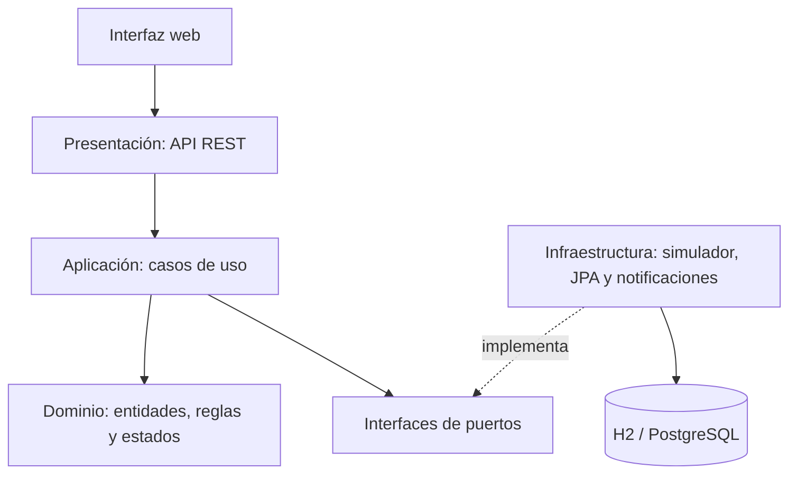
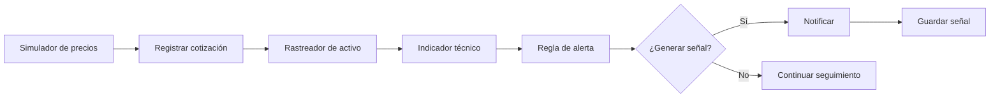
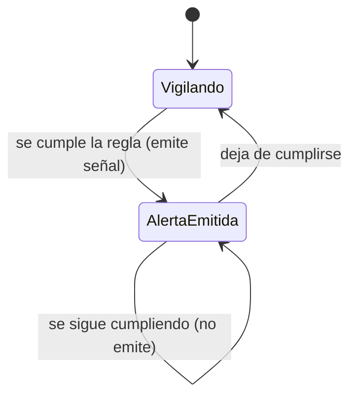

# Plataforma de Trading y Alertas de Inversión

> **Proyecto académico** · Java · Spring Boot · Programación Orientada a Objetos

Plataforma educativa para **simular cotizaciones de activos financieros**, calcular indicadores técnicos y generar alertas cuando se cumplan reglas de negocio configuradas. El proyecto está enfocado en aplicar los **cuatro pilares de la Programación Orientada a Objetos (POO)**, los principios **SOLID**, patrones de diseño y pruebas automatizadas.

> [!IMPORTANT]
> Este sistema utiliza información simulada y genera señales con fines educativos. **No ejecuta operaciones financieras ni proporciona asesoramiento de inversión.**

## Objetivo

Diseñar e implementar una aplicación modular que permita estudiar la colaboración entre objetos, el encapsulamiento del estado, el polimorfismo y la separación de responsabilidades, sin requerir una arquitectura de microservicios ni infraestructura distribuida.

## Funcionalidades previstas

- **Gestión de activos:** seguimiento de criptomonedas, divisas y acciones simuladas (mínimo cinco activos).
- **Simulación de mercado:** generación periódica de cotizaciones con precio y fecha de registro.
- **Historial:** consulta de cotizaciones almacenadas.
- **Análisis técnico:** cálculo de media móvil simple (**SMA**) y posibilidad de agregar otras estrategias, como **EMA**.
- **Reglas de alerta:** generación de señales simuladas al superar umbrales definidos.
- **Control de estados:** prevención de alertas duplicadas mientras persista una condición.
- **Notificaciones:** mensajes en consola y posibilidad de incorporar otros canales.
- **Visualización:** panel de precios y panel de alertas mediante una interfaz web sencilla.

## Tecnologías

| Área | Tecnología |
| --- | --- |
| Lenguaje | Java 17 o superior |
| Backend | Spring Boot |
| Gestión de dependencias | Maven |
| Persistencia | Spring Data JPA + H2 (o PostgreSQL, opcional) |
| Pruebas | JUnit 5 y Mockito |
| Interfaz | HTML, CSS y JavaScript |

No es necesario utilizar Kafka, RabbitMQ, Docker, Kubernetes ni microservicios. La aplicación se ejecuta como **un único proyecto Spring Boot**.

## Enfoque de Programación Orientada a Objetos

| Concepto | Aplicación en el proyecto |
| --- | --- |
| **Encapsulamiento** | Las entidades protegen sus invariantes y ofrecen métodos como `registrarCotizacion()` o `marcarNotificada()` en lugar de setters indiscriminados. |
| **Abstracción** | Interfaces como `IndicadorTecnico`, `ProveedorPrecios`, `Notificador` y los repositorios separan los contratos de las implementaciones. |
| **Polimorfismo** | Es posible cambiar entre SMA, EMA u otros indicadores sin modificar el servicio que los utiliza. |
| **Herencia y composición** | Se prioriza la composición; la herencia se utiliza solamente cuando existe una relación válida de especialización. |
| **SOLID** | Cada componente mantiene una responsabilidad clara y depende de abstracciones. |

### Patrones de diseño

- **Strategy:** intercambiar algoritmos de indicadores técnicos.
- **State:** gestionar los estados del seguimiento y evitar alertas repetidas.
- **Repository:** desacoplar la lógica de dominio del almacenamiento.

Además se usa **inyección de dependencias por constructor** para entregar las implementaciones a los servicios.

## Arquitectura

La solución utiliza una arquitectura de **monolito modular**, organizada en cuatro capas:



- **Dominio:** contiene las reglas financieras, entidades, objetos de valor y contratos necesarios para el comportamiento de los objetos.
- **Aplicación:** coordina los casos de uso sin asumir reglas que pertenecen al dominio.
- **Infraestructura:** implementa el simulador de precios, los repositorios y los canales de notificación.
- **Presentación:** ofrece endpoints REST y recursos web para consultar los resultados.

### Modelo de dominio previsto

| Clase / interfaz | Responsabilidad |
| --- | --- |
| `ActivoFinanciero` | Identidad y datos de cada activo |
| `CodigoActivo`, `Precio` | Objetos de valor inmutables y validados |
| `Cotizacion` | Precio de un activo en un instante dado |
| `RastreadorActivo` | Historial reciente y estado del activo |
| `IndicadorTecnico` | Contrato de cálculo de indicadores |
| `MediaMovilSimple`, `MediaMovilExponencial` | Estrategias de indicadores |
| `ReglaDeAlerta` | Contrato de las condiciones para emitir señales |
| `ReglaPrecioSobreMedia` | Evalúa si el precio supera la media en un porcentaje |
| `EstadoSeguimiento`, `Vigilando`, `AlertaEmitida` | Comportamiento del seguimiento según su estado |
| `SenalInversion` | Resultado de una regla y estado de notificación |
| `ProveedorPrecios` | Contrato para obtener cotizaciones |
| `Notificador` | Contrato para informar una señal |
| `RepositorioCotizaciones`, `RepositorioSenales` | Contratos de persistencia |

## Flujo principal



**Regla inicial:** si el precio actual supera en más del **5 %** la media móvil simple de las **cinco cotizaciones anteriores** (sin incluir la actual), se genera una señal educativa.

```math
SMA_5 = \frac{P_1 + P_2 + P_3 + P_4 + P_5}{5}
```

```math
PrecioActual > SMA_5 \times 1.05
```

La señal no se repite mientras se mantenga la condición. Para eso se usa el patrón State:



## Organización del repositorio

```text
poo-trading/
├── pom.xml
├── README.md
├── src/
│   ├── main/
│   │   ├── java/com/m4nuvr/trading/
│   │   │   ├── domain/
│   │   │   │   ├── model/
│   │   │   │   ├── strategy/
│   │   │   │   ├── state/
│   │   │   │   ├── rules/
│   │   │   │   └── port/
│   │   │   ├── application/
│   │   │   ├── infrastructure/
│   │   │   │   ├── simulation/
│   │   │   │   ├── persistence/
│   │   │   │   ├── notification/
│   │   │   │   └── config/
│   │   │   ├── web/
│   │   │   └── TradingApplication.java
│   │   └── resources/
│   │       ├── application.properties
│   │       └── static/
│   └── test/java/com/m4nuvr/trading/
```

## Requisitos para ejecutar el proyecto

- **JDK 17 o superior** instalado y configurado.
- **Maven** instalado.
- Una terminal y un IDE compatible con Java (opcional).

### Puesta en marcha

1. Clona el repositorio:

   ```bash
   git clone https://github.com/M4nuVR/poo-trading.git
   cd poo-trading
   ```

2. Comprueba Java y Maven:

   ```bash
   java -version
   mvn -version
   ```

3. Ejecuta las pruebas:

   ```bash
   mvn test
   ```

4. Inicia la aplicación:

   ```bash
   mvn spring-boot:run
   ```

5. Abre `http://localhost:8080` para ver el panel. Los precios se actualizan cada 3 segundos y las alertas también se imprimen en consola.

### API REST

| Método | Ruta | Descripción |
| --- | --- | --- |
| GET | `/api/activos` | Activos con su último precio y estado de seguimiento |
| GET | `/api/activos/{codigo}/cotizaciones` | Últimas 30 cotizaciones de un activo |
| GET | `/api/senales` | Últimas 20 señales generadas |

La consola de H2 queda disponible en `/h2-console` (URL JDBC `jdbc:h2:mem:trading`, usuario `sa`).

## Pruebas

Las pruebas unitarias están escritas con **JUnit 5** y **Mockito** y se ejecutan con `mvn test`.

Casos verificados:

- Validación de precios positivos y códigos de activos correctos.
- Cálculo de SMA y otros indicadores.
- Comportamiento cuando no hay suficientes cotizaciones.
- Generación de señales ante el umbral configurado.
- Transiciones de estado y prevención de señales duplicadas.
- Intercambio de estrategias por polimorfismo.
- Colaboración entre servicios, repositorios y notificadores usando dobles de prueba.

Las pruebas del dominio se ejecutan **sin iniciar Spring Boot ni una base de datos real**.

## Explicación del código

1. `TareaSimulacion` llama cada 3 segundos a `ServicioMercado.actualizarMercado()`.
2. El servicio pide una cotización nueva a `ProveedorPrecios` (implementado por `SimuladorPrecios`, que varía el precio hasta ±4 %) y la guarda en `RepositorioCotizaciones`.
3. Cada activo tiene un `RastreadorActivo` que guarda su historial reciente y su estado (`Vigilando` o `AlertaEmitida`).
4. El rastreador consulta la `ReglaDeAlerta`. La regla usa un `IndicadorTecnico` (SMA o EMA) sin saber cuál es: eso es Strategy y polimorfismo.
5. Si la regla se cumple y el estado lo permite, se crea una `SenalInversion`, se envía al `Notificador` (consola) y se guarda en `RepositorioSenales`.
6. El dominio solo conoce interfaces (`domain/port`). La infraestructura (JPA, simulador, consola) las implementa, y `ConfiguracionTrading` arma todo. Para cambiar a EMA basta con devolver `new MediaMovilExponencial(5)` en esa clase.
7. `MercadoController` expone la API y la página en `static/` la consulta para mostrar los paneles.

## Plan de desarrollo

- [x] Definir el modelo de dominio.
- [ ] Diagrama de clases UML.
- [x] Implementar objetos de valor y entidades con validaciones.
- [x] Implementar la simulación y el registro de cotizaciones.
- [x] Incorporar Strategy para el cálculo de SMA y EMA.
- [x] Implementar reglas de alertas y estados del seguimiento.
- [x] Crear repositorios y persistencia con JPA.
- [x] Implementar notificaciones mediante interfaces.
- [x] Exponer consultas mediante API REST.
- [x] Crear los paneles de mercado y alertas.
- [x] Pruebas unitarias y documentación técnica.

## Alcance

Este repositorio es una **simulación académica**. No contempla integración obligatoria con exchanges reales, compra o venta de activos, cuentas de inversión, microservicios, mensajería distribuida ni despliegue en producción.

---

**Prioridad del proyecto:** calidad del modelo orientado a objetos, cumplimiento de SOLID, uso justificado de patrones de diseño y pruebas del comportamiento del sistema.
