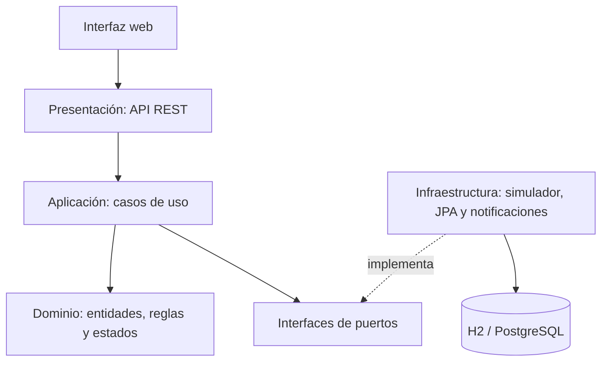
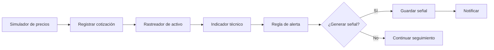

# Plataforma de Trading y Alertas de Inversión

> **Proyecto académico en desarrollo** · Java · Spring Boot · Programación Orientada a Objetos

Plataforma educativa para **simular cotizaciones de activos financieros**, calcular indicadores técnicos y generar alertas cuando se cumplan reglas de negocio configuradas. El proyecto está enfocado en aplicar los **cuatro pilares de la Programación Orientada a Objetos (POO)**, los principios **SOLID**, patrones de diseño y pruebas automatizadas.

> [!IMPORTANT]
> Este sistema utiliza información simulada y genera señales con fines educativos. **No ejecuta operaciones financieras ni proporciona asesoramiento de inversión.**

## Objetivo

Diseñar e implementar una aplicación modular que permita estudiar la colaboración entre objetos, el encapsulamiento del estado, el polimorfismo y la separación de responsabilidades, sin requerir una arquitectura de microservicios ni infraestructura distribuida.

## Funcionalidades previstas

- **Gestión de activos:** seguimiento de criptomonedas, divisas y acciones simuladas (mínimo cinco activos).
- **Simulación de mercado:** generación periódica de cotizaciones con precio y fecha de registro.
- **Historial:** consulta de cotizaciones almacenadas.
- **Análisis técnico:** cálculo de media móvil simple (**SMA**) y posibilidad de agregar otras estrategias, como **EMA**.
- **Reglas de alerta:** generación de señales simuladas al superar umbrales definidos.
- **Control de estados:** prevención de alertas duplicadas mientras persista una condición.
- **Notificaciones:** mensajes en consola y posibilidad de incorporar otros canales.
- **Visualización:** panel de precios y panel de alertas mediante una interfaz web sencilla.

## Tecnologías

| Área | Tecnología |
| --- | --- |
| Lenguaje | Java 17 o superior |
| Backend | Spring Boot |
| Gestión de dependencias | Maven |
| Persistencia | Spring Data JPA + H2 (o PostgreSQL, opcional) |
| Pruebas | JUnit 5 y Mockito |
| Interfaz | HTML, CSS y JavaScript |

No es necesario utilizar Kafka, RabbitMQ, Docker, Kubernetes ni microservicios. La aplicación se ejecuta como **un único proyecto Spring Boot**.

## Enfoque de Programación Orientada a Objetos

| Concepto | Aplicación en el proyecto |
| --- | --- |
| **Encapsulamiento** | Las entidades protegen sus invariantes y ofrecen métodos como `registrarCotizacion()` o `marcarNotificada()` en lugar de setters indiscriminados. |
| **Abstracción** | Interfaces como `IndicadorTecnico`, `ProveedorPrecios`, `Notificador` y los repositorios separan los contratos de las implementaciones. |
| **Polimorfismo** | Es posible cambiar entre SMA, EMA u otros indicadores sin modificar el servicio que los utiliza. |
| **Herencia y composición** | Se prioriza la composición; la herencia se utiliza solamente cuando existe una relación válida de especialización. |
| **SOLID** | Cada componente mantiene una responsabilidad clara y depende de abstracciones. |

### Patrones de diseño

- **Strategy:** intercambiar algoritmos de indicadores técnicos.
- **State:** gestionar los estados del seguimiento y evitar alertas repetidas.
- **Repository:** desacoplar la lógica de dominio del almacenamiento.
- **Inyección de dependencias:** suministrar implementaciones a los servicios mediante constructores.

## Arquitectura

La solución utiliza una arquitectura de **monolito modular**, organizada en cuatro capas:



- **Dominio:** contiene las reglas financieras, entidades, objetos de valor y contratos necesarios para el comportamiento de los objetos.
- **Aplicación:** coordina los casos de uso sin asumir reglas que pertenecen al dominio.
- **Infraestructura:** implementa el simulador de precios, los repositorios y los canales de notificación.
- **Presentación:** ofrece endpoints REST y recursos web para consultar los resultados.

### Modelo de dominio previsto

| Clase / interfaz | Responsabilidad |
| --- | --- |
| `ActivoFinanciero` | Identidad y datos de cada activo |
| `CodigoActivo`, `Precio` | Objetos de valor inmutables y validados |
| `Cotizacion` | Precio de un activo en un instante dado |
| `RastreadorActivo` | Historial reciente y estado del activo |
| `IndicadorTecnico` | Contrato de cálculo de indicadores |
| `MediaMovilSimple`, `MediaMovilExponencial` | Estrategias de indicadores |
| `ReglaDeAlerta` | Contrato de las condiciones para emitir señales |
| `ReglaDeAlertaPorMomentum` | Evaluación del umbral de momentum |
| `EstadoSeguimiento` | Comportamiento del seguimiento según su estado |
| `SenalInversion` | Resultado de una regla y estado de notificación |
| `ProveedorPrecios` | Contrato para obtener cotizaciones |
| `Notificador` | Contrato para informar una señal |
| `RepositorioCotizaciones`, `RepositorioSenales` | Contratos de persistencia |

## Flujo principal



**Ejemplo de regla inicial:** si el precio actual supera en más del **5 %** la media móvil simple de las últimas cinco cotizaciones, se puede generar una señal educativa.

\[
SMA_5 = \frac{P_1 + P_2 + P_3 + P_4 + P_5}{5}
\]

\[
PrecioActual > SMA_5 \times 1.05
\]

La señal no debe repetirse continuamente mientras se mantenga la condición; el seguimiento volverá a estar habilitado cuando la condición desaparezca.

## Organización propuesta del repositorio

> La siguiente estructura representa la **organización objetivo**. Puede cambiar durante la implementación.

```text
trading-alertas-poo/
├── pom.xml
├── README.md
├── src/
│   ├── main/
│   │   ├── java/com/ejemplo/trading/
│   │   │   ├── domain/
│   │   │   │   ├── model/
│   │   │   │   ├── strategy/
│   │   │   │   ├── state/
│   │   │   │   ├── rules/
│   │   │   │   └── port/
│   │   │   ├── application/
│   │   │   ├── infrastructure/
│   │   │   │   ├── simulation/
│   │   │   │   ├── persistence/
│   │   │   │   └── notification/
│   │   │   ├── web/
│   │   │   └── TradingApplication.java
│   │   └── resources/
│   │       ├── application.properties
│   │       └── static/
│   └── test/java/
```

## Requisitos para ejecutar el proyecto

- **JDK 17 o superior** instalado y configurado.
- **Maven** disponible, o Maven Wrapper (`mvnw`) si se incluye en el repositorio.
- Una terminal y un IDE compatible con Java (opcional).

### Puesta en marcha (cuando esté implementado)

1. Clona el repositorio:

   ```bash
   git clone <URL_DEL_REPOSITORIO>
   cd <NOMBRE_DEL_REPOSITORIO>
   ```

2. Comprueba Java y Maven:

   ```bash
   java -version
   mvn -version
   ```

3. Ejecuta las pruebas:

   ```bash
   mvn test
   ```

4. Inicia la aplicación:

   ```bash
   mvn spring-boot:run
   ```

5. Cuando exista el controlador web o la interfaz, consulta la ruta y el puerto definidos en `application.properties` (Spring Boot usa el puerto `8080` por defecto, salvo configuración distinta).

> Los comandos de ejecución requieren que el código fuente y el archivo `pom.xml` ya estén presentes. Las rutas REST definitivas se documentarán a medida que se implementen; no se consideran disponibles todavía.

## Pruebas

Las pruebas unitarias tendrán prioridad sobre las pruebas de infraestructura y se escribirán con **JUnit 5** y **Mockito**.

Casos principales que se verificarán:

- Validación de precios positivos y códigos de activos correctos.
- Cálculo de SMA y otros indicadores.
- Comportamiento cuando no hay suficientes cotizaciones.
- Generación de señales ante el umbral configurado.
- Transiciones de estado y prevención de señales duplicadas.
- Intercambio de estrategias por polimorfismo.
- Colaboración entre servicios, repositorios y notificadores usando dobles de prueba.

Las pruebas del dominio deben ejecutarse **sin iniciar Spring Boot ni una base de datos real**.

## Plan de desarrollo

- [ ] Definir el modelo de dominio y el diagrama de clases UML.
- [ ] Implementar objetos de valor y entidades con validaciones.
- [ ] Implementar la simulación y el registro de cotizaciones.
- [ ] Incorporar Strategy para el cálculo de SMA y EMA.
- [ ] Implementar reglas de alertas y estados del seguimiento.
- [ ] Crear repositorios y persistencia con JPA.
- [ ] Implementar notificaciones mediante interfaces.
- [ ] Exponer consultas mediante API REST.
- [ ] Crear los paneles de mercado y alertas.
- [ ] Completar las pruebas unitarias y documentación técnica.

## Alcance

Este repositorio es una **simulación académica**. No contempla integración obligatoria con exchanges reales, compra o venta de activos, cuentas de inversión, microservicios, mensajería distribuida ni despliegue en producción.

---

**Prioridad del proyecto:** calidad del modelo orientado a objetos, cumplimiento de SOLID, uso justificado de patrones de diseño y pruebas del comportamiento del sistema.
